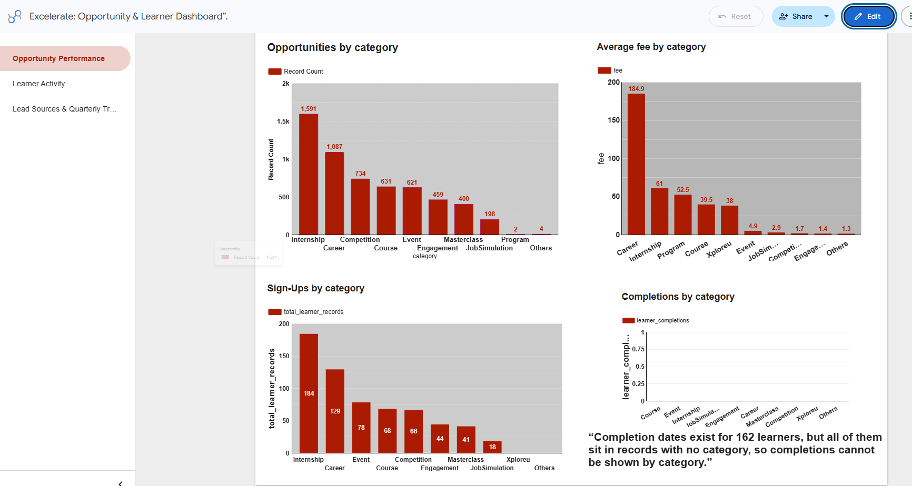
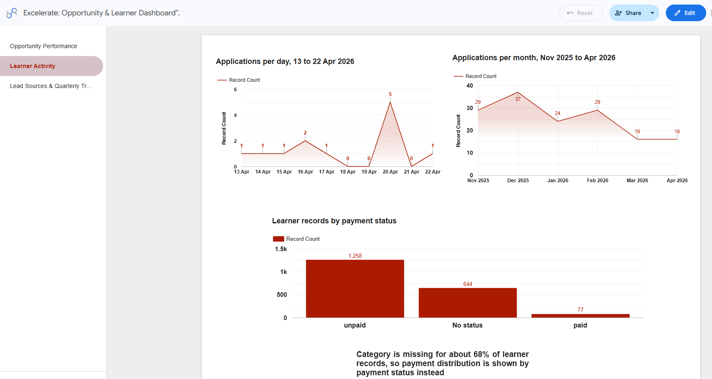
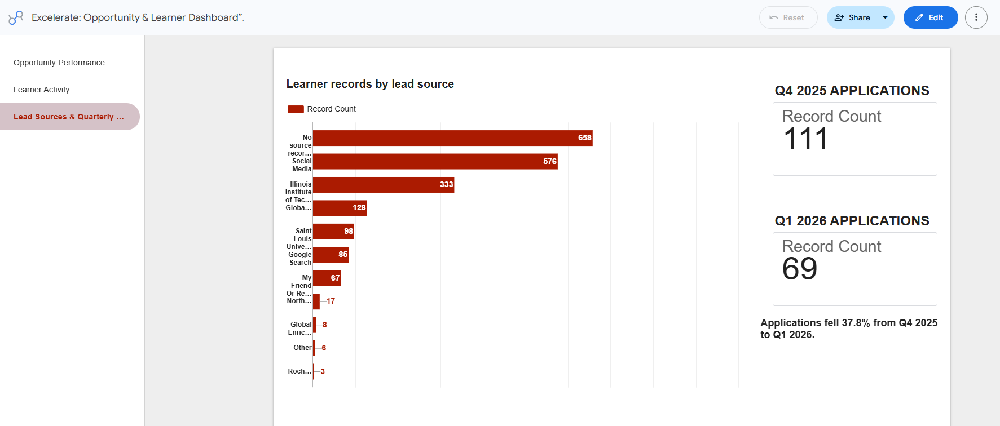

# excelerate-learner-opportunity-analysis.
Data cleaning, integration, and SQL validation scripts for the Excelerate Data Analytics internship project, built in PostgreSQL and visualised in Looker Studio.


# Excelerate: Opportunity & Learner Performance Analysis

An end-to-end analysis of two programme datasets: what opportunities were on offer, and how learners applied, paid and completed. The project covers database setup, SQL exploration, data cleaning, integration, a Looker Studio dashboard and recommendations.

**Dashboard:** (https://datastudio.google.com/reporting/49e1df4f-fc72-4876-a9a9-560a5ccae1c0)
### Dashboard Previews
**Page 1: Opportunity Performance**


**Page 2: Learner Activity**


**Page 3: Lead Sources & Trend**


**Final presentation:** see `reports/`

## Business questions

- Which opportunity categories dominate, and what do they cost?
- How have applications changed over time?
- Which lead sources bring in the most learners?
- How many learners pay and complete?

## Tools

PostgreSQL (hosted on Supabase) · SQL · Looker Studio · Google Sheets

## Data

| Dataset | Records | Fields |
|---|---|---|
| Opportunity Data | 5,733 | 33 |
| Learner Data | 1,979 | 256 (44 named) |

The raw data is not included in this repository because it contains learner information from the programme.

## Approach

1. **Setup:** created a Supabase PostgreSQL database, imported both CSV files and checked row counts against the source files.
2. **Exploration:** profiled structure, categories, missing values and duplicates with SQL.
3. **Cleaning:** worked on copies of each table. Standardised labels, converted text to numeric and date types, and removed invalid values.
4. **Integration:** tested seven candidate join keys, found no reliable record-level link, and built a category-level summary view instead.
5. **Dashboard and validation:** built nine charts in Looker Studio and reconciled every figure to a SQL query.

## Key findings

- Internship, Career and Competition make up about 60% of the 5,727 cleaned opportunities.
- Applications in Q1 2026 were 37.8% lower than in Q4 2025 (111 down to 69).
- Social media (44%) and four partner universities (34%) account for most learners with a known lead source.
- Only 5.8% of learners with a payment status are marked as paid.

## Data quality issues found

- Inconsistent labels, for example 23 location values reduced to 14 after standardising.
- Eight impossible payment amounts that pushed one chart total to about 30 trillion.
- Hidden whitespace in a text field that made a join return nothing.
- 212 of 256 Learner Data columns were unnamed in the export.
- No field linking a learner to a specific opportunity.

## Limitations

- The category-level integration covers 628 of 1,979 learner records, because 68% have no category.
- The data ends on 22 April 2026.
- Fees mix USD, INR and EUR.

## Repository structure

```
sql/        SQL scripts for setup checks, exploration, cleaning, integration and validation
reports/    Week 1 to 3 reports and the final presentation (PDF)
images/     Dashboard screenshots
```

## Author

Emmanuel Erioluwa Olowodu · https://www.linkedin.com/in/emmanuel-olowodu/
